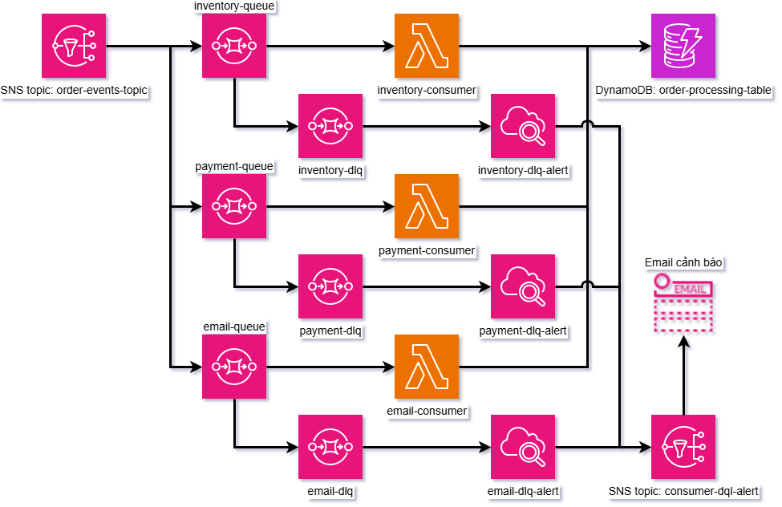
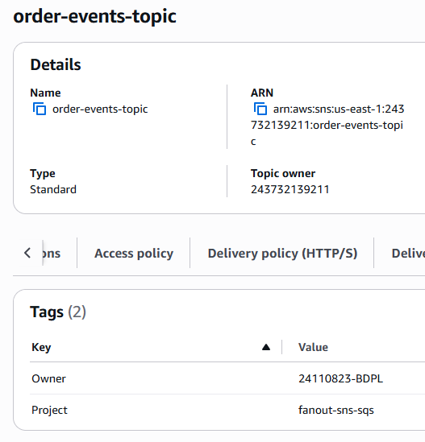
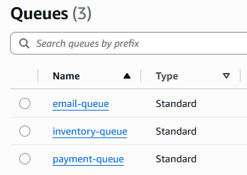
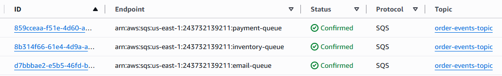
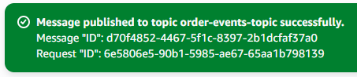
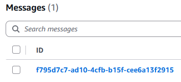
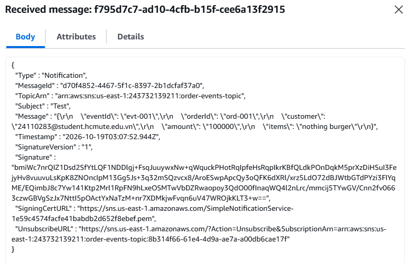
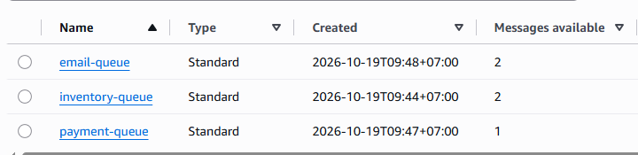

# Kiến trúc fan-out với SNS và nhiều hàng đợi SQS 
# Tuần 1
## Worklog
- Tìm hiểu dịch vụ: 3 tiếng
    - Đọc [What is Amazon SNS?](https://docs.aws.amazon.com/sns/latest/dg/welcome.html)
    - Đọc [Amazon SNS message filtering](https://docs.aws.amazon.com/sns/latest/dg/sns-message-filtering.html)
    - Đọc [What is Amazon Simple Queue Service?](https://docs.aws.amazon.com/AWSSimpleQueueService/latest/SQSDeveloperGuide/welcome.html)
    - Đọc [Using Lambda with Amazon SQS](https://docs.aws.amazon.com/lambda/latest/dg/with-sqs.html)
    - Đọc [Tutorial: Using Lambda with Amazon SQS](https://docs.aws.amazon.com/lambda/latest/dg/with-sqs-example.html)
    - Xem [AWS Fan-Out Pattern: Amazon SNS + Amazon SQS Setup](https://www.youtube.com/watch?v=h8OUc38eKi4)
    - Vẽ sơ đồ dùng [app.diagrams.net](https://app.diagrams.net/): 15 phút

- Thiết kế kiến trúc: 5 tiếng

## 1. Tìm hiểu dịch vụ
- SNS (Simple Notification Service) là dịch vụ nhắn tin Publisher/Subscriber. Khi một tin nhắn đi vào Topic, tin nhắn đó được gửi đến tất cả consumer có subscribe topic đó.
- SNS message filtering: Thay vì nhận mọi tin nhắn từ topic, dùng filter để lọc và chỉ lấy những tin nhắn cần thiết. SNS so sánh cấu trúc giữa tin nhắn và filter nếu hai bên giống nhau, subscriber nhận tin nhắn đó. Nếu subscriber không có filter, nó nhận mọi tin nhắn từ topic.
- SQS (Simple Queue Service) là dịch vụ hàng đợi tin nhắn. Giữ tin nhắn để consumer dùng.
- Fan-out là khi ta sử dụng SNS để gửi tin nhắn đến nhiều endpoint. Một consumer bị chậm/lỗi không ảnh hướng tới các consumer khác. Có thể mở rộng lên đến hàng triệu subscriber.

## 2. Thiết kế kiến trúc
### Đặt tên:
```
order-events-topic
inventory-queue
payment-queue
email-queue
```

### Tag:
```
Project = fanout-sns-sqs
Owner = 24110283-BDPL
```

### JSON:
``` json
{
    "eventId":,
    "orderId":,
    "customer":,
    "amount":,
    "items":
}
```

- eventId: mã sự kiện
- orderId: mã đơn hàng
- customer: tên nhận biết khách hàng (email, số điện thoại,...)
- amount: số tiền
- item: hàng

### Filter
- Filter của inventory-queue: tạo hoặc hủy đơn hàng
``` json
{
    "eventType": ["ORDER_CREATED", "ORDER_CANCELLED"]
}
```

- Filter của payment-queue: tạo hoặc hủy đơn hàng, phương thức thanh toán bằng thẻ hoặc ví điện tử
``` json
{
    "eventType": ["ORDER_CREATED", "ORDER_CANCELLED"],
    "paymentMethod": ["CARD", "MOMO"]
}
```

- Filter của email-queue: tạo đơn hàng, hủy đơn hàng, đã giao đơn hàng
``` json
{
    "eventType": ["ORDER_CREATED", "ORDER_CANCELLED", "ORDER_SHIPPED"]
}
```

## 3. Vẽ sơ đồ



## 4. Dựng nền tảng
### Tạo order-events-topic
#### Amazon SNS > Topics > Create topic
- Type: standard
- Name: order-events-topic
- Tags: `Project = fanout-sns-sqs` `Owner = 24110283-BDPL`



### Tạo inventory-queue, payment-queue, email-queue
#### Amazon SQS > Queues > Create queue
- Type: Standard
- Name: inventory-queue, payment-queue, email-queue
- Tags: `Project = fanout-sns-sqs` `Owner = 24110283-BDPL`

- Kết quả tạo được 3 queue có tên lần lượt inventory-queue, payment-queue, email-queue



### Tạo subscription cho các queue
#### Amazon SNS > Topics > order-events-topic > Create subscription
- Topic ARN: chọn ARN của order-events-topic
- Protocol: Amazon SQS
- Endpoint: chọn ARN của các queue tương ứng

- Kết quả tạo được ba subscription có topic là order-events-topic và endpoint là ba queue inventory-queue, payment-queue, email-queue



### Kiểm tra
#### Publish tin nhắn
#### Amazon SNS > Topics > order-events-topic > Publish message
- Subject: Test
- Message body to send to the endpoint:
``` json
{
    "eventId": "evt-001",
    "orderId": "ord-001",
    "customer": "24110283@student.hcmute.edu.vn",
    "amount": "100000",
    "items": "nothing burger"
}
```

- Kết quả Publish tin nhắn thành công



#### Nhận tin nhắn
#### Amazon SQS > Queues > inventory-queue, payment-queue, email-queue > Send and receive messages
- Kiểm tra thấy cả ba queue nhận được tin nhắn thành công



- Nội dung đúng với tin nhắn đã publish



### Tạo filter
#### Amazon SNS > Subscription > Chọn subcription tương ứng > Edit
- Subscription filter policy
- Dùng Message attributes
- Dán filter tương ứng vào JSON editor

### Kiểm tra
#### Amazon SNS > Topics > order-events-topic > Publish message
- Subject: Test Filter
- Message body to send to the endpoint:
``` json
{
    "eventId": "evt-002",
    "orderId": "ord-002",
    "customer": "24110283@student.hcmute.edu.vn",
    "amount": "50000",
    "items": "nothing pickle"
}
```

- Message attributes:
`String      eventType       ORDER_CREATED`
`String      paymentMethod   COD`

- Kết quả: tin nhắn được nhận bởi email-queue và inventory-queue, payment-queue không nhận vì phương thức thanh toán là COD (Cash on delivery)

- email-queue có 2 tin nhắn
- inventory-queue có 2 tin nhắn
- payment-queue có 1 tin nhắn



## Links
- Repo: https://github.com/BM910/24110283_CLCO332779_05UTExMC
- File báo cáo: https://github.com/BM910/24110283_CLCO332779_05UTExMC/blob/main/tuan_01/bao_cao_tuan_1.md
- Sơ đồ kiến trúc: https://github.com/BM910/24110283_CLCO332779_05UTExMC/blob/main/tuan_01/draw_so_do.jpg
- Commits:
    - https://github.com/BM910/24110283_CLCO332779_05UTExMC/commit/36206c43617d3c388437d8a10757718fa12e535c
    - https://github.com/BM910/24110283_CLCO332779_05UTExMC/commit/859b6ee19591f4424c6325a22ea0886c3e380726
    - https://github.com/BM910/24110283_CLCO332779_05UTExMC/commit/74eca597e022d5d39b49135ac65be0e17b4ee3f5
- Ảnh:
    - [create_queue.png](https://github.com/BM910/24110283_CLCO332779_05UTExMC/blob/859b6ee19591f4424c6325a22ea0886c3e380726/tuan_01/create_queue.png)
    - [create_subscription.png](https://github.com/BM910/24110283_CLCO332779_05UTExMC/blob/859b6ee19591f4424c6325a22ea0886c3e380726/tuan_01/create_subscription.png)
    - [create_topic.png](https://github.com/BM910/24110283_CLCO332779_05UTExMC/blob/859b6ee19591f4424c6325a22ea0886c3e380726/tuan_01/create_topic.png)
    - [draw_so_do.jpg](https://github.com/BM910/24110283_CLCO332779_05UTExMC/blob/859b6ee19591f4424c6325a22ea0886c3e380726/tuan_01/draw_so_do.jpg)
    - [publish_message_success.png](https://github.com/BM910/24110283_CLCO332779_05UTExMC/blob/859b6ee19591f4424c6325a22ea0886c3e380726/tuan_01/publish_message_success.png)
    - [receive_message_body.png](https://github.com/BM910/24110283_CLCO332779_05UTExMC/blob/859b6ee19591f4424c6325a22ea0886c3e380726/tuan_01/receive_message_body.png)
    - [receive_message_filter_queue_list.png](https://github.com/BM910/24110283_CLCO332779_05UTExMC/blob/859b6ee19591f4424c6325a22ea0886c3e380726/tuan_01/receive_message_filter_queue_list.png)
    - [receive_message_inventory_queue.png](https://github.com/BM910/24110283_CLCO332779_05UTExMC/blob/859b6ee19591f4424c6325a22ea0886c3e380726/tuan_01/receive_message_inventory_queue.png)

## Sử dụng AI: Không sử dụng

## Kế hoạch tuần 2
Triển khai chức năng lõi và kiểm thử từng thành phần: ba Lambda consumer dùng LabRole với concurrency trong giới hạn 10, tạo DLQ cho ba queue, và kịch bản kiểm thử các tổ hợp filter.