# Kiến trúc fan-out với SNS và nhiều hàng đợi SQS 
# Tuần 2
## Worklog
- Tìm hiểu dịch vụ: 2 tiếng
    - Đọc [What is AWS Lambda?](https://docs.aws.amazon.com/lambda/latest/dg/welcome.html)
    - Đọc [AWS Lambda Event Functions (formerly Lambda functions)](https://docs.aws.amazon.com/lambda/latest/dg/lambda-functions-chapter.html)
    - Đọc [Create your first Lambda function](https://docs.aws.amazon.com/lambda/latest/dg/getting-started.html)
    - Đọc [Tutorial: Using Lambda with Amazon SQS](https://docs.aws.amazon.com/lambda/latest/dg/with-sqs-example.html)
    - Đọc [Using dead-letter queues in Amazon SQS](https://docs.aws.amazon.com/AWSSimpleQueueService/latest/SQSDeveloperGuide/sqs-dead-letter-queues.html)
    - Đọc [Configure a dead-letter queue using the Amazon SQS console](https://docs.aws.amazon.com/AWSSimpleQueueService/latest/SQSDeveloperGuide/sqs-configure-dead-letter-queue.html)
    - Đọc [Creating and configuring an Amazon SQS event source mapping](https://docs.aws.amazon.com/lambda/latest/dg/services-sqs-configure.html)
    - Xem [AWS SNS & SQS Hands-On Lab | Fanout Pattern, DLQ & Lambda Trigger | SAA-C03 Module 9.2](https://www.youtube.com/watch?v=pkVpmIvrp9M)
    - Xem [AWS Serverless: Invoke Lambda function asynchronously and use DLQ for failed events](https://www.youtube.com/watch?v=ifuQc6Bo3B8)

- Triển khai kiến trúc: 6 tiếng
    - Tạo và cài đặt 3 dead letter queue
    - Tạo và cài đặt 3 event function (lambda)
    - Chạy kiểm tra filter, dead letter queue và event function (lambda)

## 1. Triển khai chức năng 
### Tạo và gắn inventory-dlq/payment-dlq/email-dlq
#### Amazon SQS > Queues > Create queue
- Type: Standard
- Name: inventory-dlq/payment-dlq/email-dlq
- Access policy: Basic
- Tags:
```
Project = fanout-sns-sqs
Owner = 24110283-BDPL
```

#### Amazon SQS > Queues > inventory-queue/payment-queue/email-queue > Edit
- Dead-letter queue: Enable
- Choose queue: chọn ARN dlq tương ứng
- Maximum receives: `3` cho phép tin nhắn bị lỗi khi gọi lambda được nhận lại vào queue tối đa 3 lần, sau 3 lần đẽ được đưa vào dead letter queue

### Tạo và gắn lambda inventory-consumer/payment-consumer/email-consumer
#### Code inventory_consumer/payment_consumer/email_consumer
#### Tạo Event Functions
#### Lambda > Event Functions > Create Event Functions
- Author from scratch
- Function name: inventory-consumer/payment-consumer/email-consumer
- Runtime: Python 3.14
- Custom execution role: LabRole
- Tags: `Project = fanout-sns-sqs` `Owner = 24110283-BDPL`

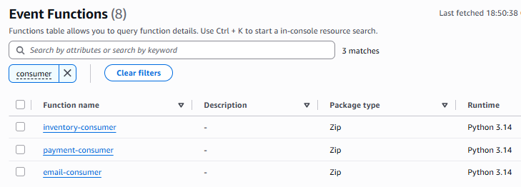

#### Config Event Functions
#### Lambda > Event Functions > inventory-consumer/payment-consumer/email-consumer
- Code: Dán đoạn code tương ứng vào và Deploy

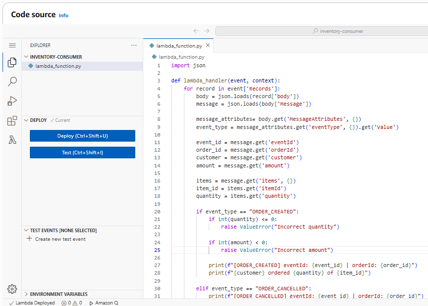

- Add triggers: `Source: SQS` `SQS queue: inventory-queue/payment-queue/email-queue` `Maximum concurrency: 3`
- Gắn hàm lambda vào queue tương ứng và sẽ hàm sẽ được gọi khi queue có tin nhắn

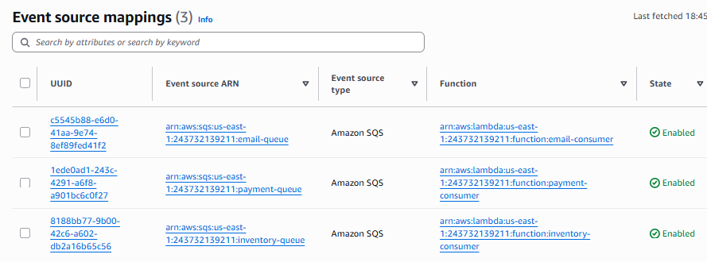

- Tags: `Project = fanout-sns-sqs` `Owner = 24110283-BDPL`

## 2. Kiểm thử
### Test 01
- Publish tin nhắn với attribute `String eventType ORDER_CREATED` `String paymentMethod CARD`
- Tin nhắn tạo đơn hàng hợp lệ, cả 3 queue sẽ nhận được tin nhắn và cả 3 lambda xử lý thành công

``` json 
{
    "eventId": "evt-001",
    "orderId": "ord-001",
    "customer": "24110283@student.hcmute.edu.vn",
    "amount": "50000",
    "items": {
        "itemId" : "hw-001",
        "quantity" : 2
    }
}
```

#### CloudWatch > Log management
#### inventory-consumer
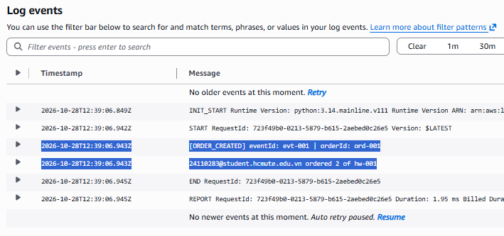

#### payment-consumer
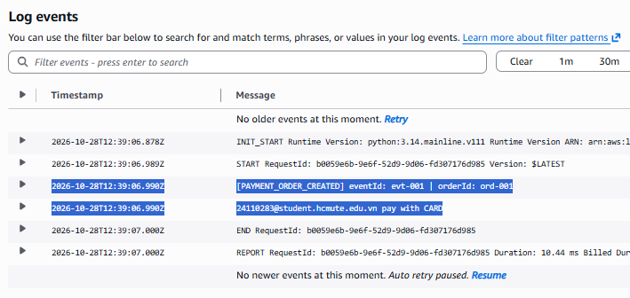

#### email-consumer
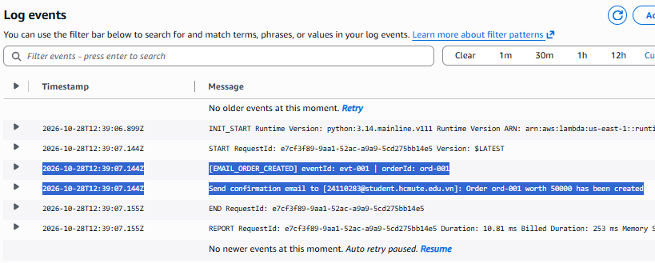

### Test 02
- Publish tin nhắn với attribute `String eventType ORDER_CANCELLED`
- Tin nhắn hủy đơn hàng, inventory-queue và email-queue nhận được tin nhắn, inventory-consumer và email-consumer xử lý thành công, payment-queue không nhận

``` json
{
    "eventId": "evt-002",
    "orderId": "ord-001",
    "customer": "24110283@student.hcmute.edu.vn",
    "amount": "",
    "items": {
        "itemId" : "",
        "quantity" : ""
    }
}
```

#### CloudWatch > Log management
#### inventory-consumer
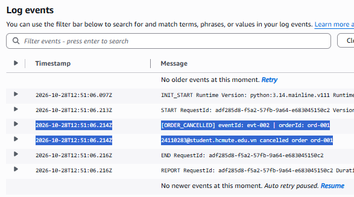

#### payment-consumer
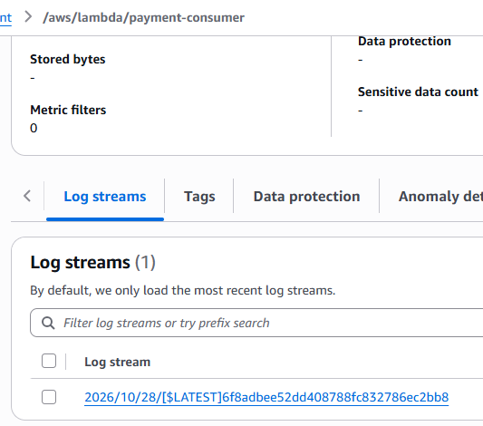

#### email-consumer
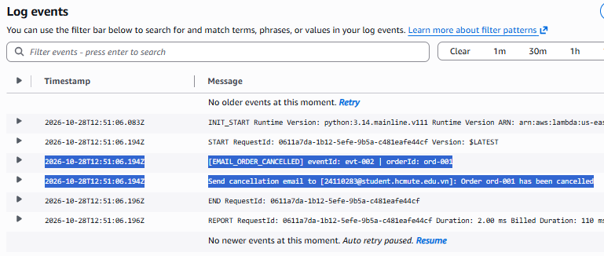

### Test 03
- Publish tin nhắn với attribute `String eventType ORDER_CREATED` `String paymentMethod CARD`
- Tin nhắn tạo đơn hàng không hợp lệ vì `amount = -400000` số tiền nhỏ hơn 0

``` json
{
    "eventId": "evt-003",
    "orderId": "ord-002",
    "customer": "24110283@student.hcmute.edu.vn",
    "amount": "-400000",
    "items": {
        "itemId" : "hw-001",
        "quantity" : 0
    }
}
```

- Sau khi publish, các tin nhắn kẹt ở `Messages in flight` vì lambda xử lý bị lỗi

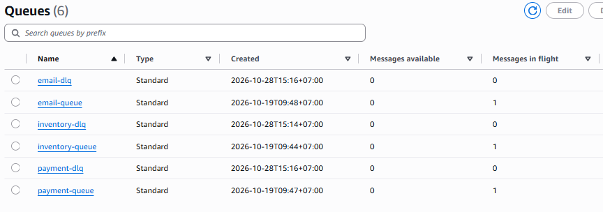

- Sau 3 lần không thành công ở mỗi queue, các tin nhắn bị đưa về dead letter queue

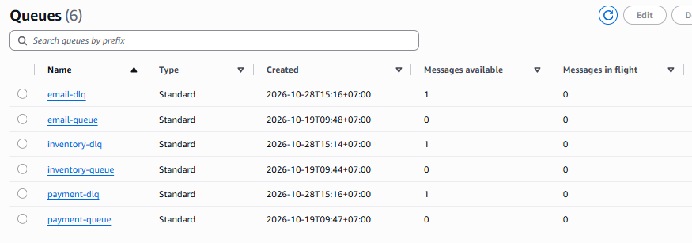

- Error metric cho thấy 3 event function gặp lỗi tổng 9 lần

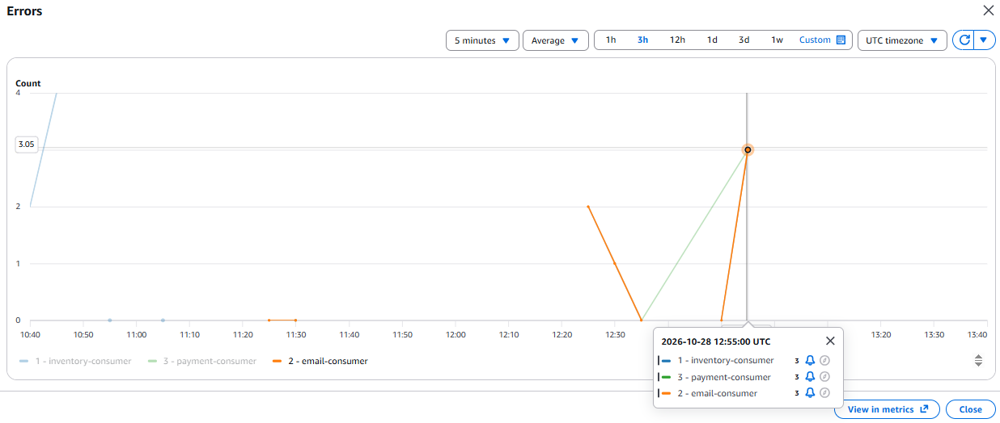

#### CloudWatch > Log management
#### inventory-consumer
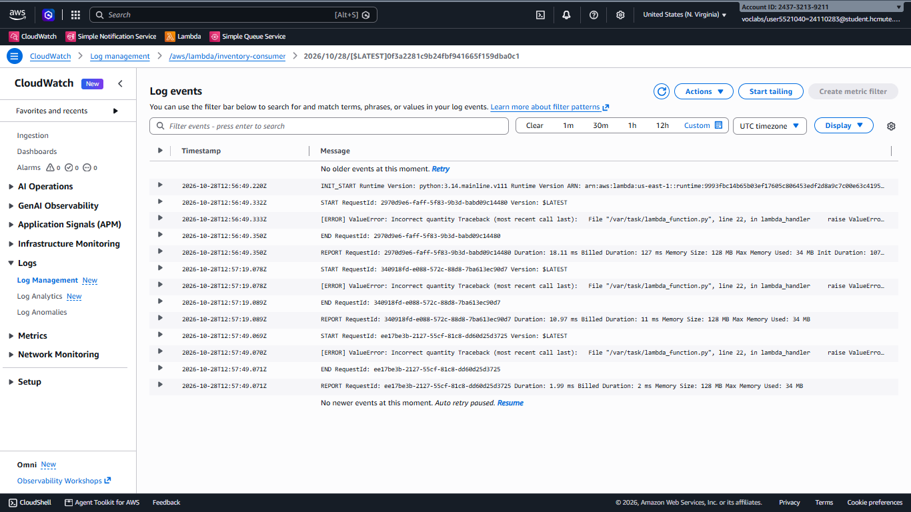

#### payment-consumer
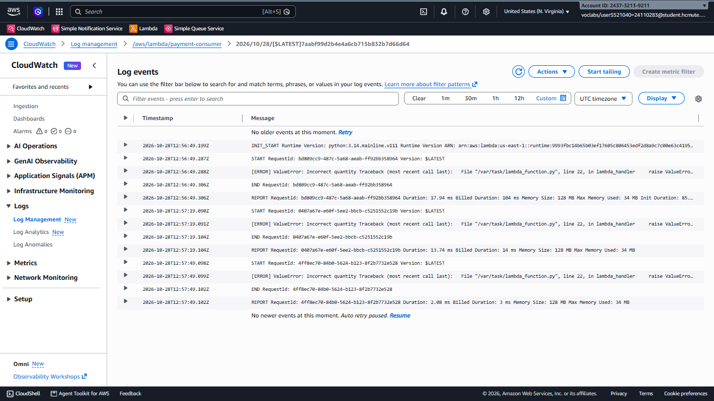

#### email-consumer
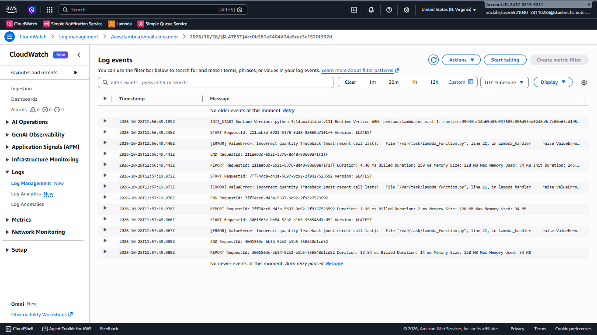

## Kế hoạch tuần 3
Tích hợp DynamoDB, bảo mật, giám sát (CloudWatch) tạo alarm của dead letter queue.