# Kiến trúc fan-out với SNS và nhiều hàng đợi SQS 
# Tuần 3
## Worklog
- Tìm hiểu dịch vụ: 2 tiếng
    - Đọc [Amazon SNS dead-letter queues](https://docs.aws.amazon.com/sns/latest/dg/sns-dead-letter-queues.html)
    - Đọc [Available CloudWatch metrics for Amazon SQS](https://docs.aws.amazon.com/AWSSimpleQueueService/latest/SQSDeveloperGuide/sqs-available-cloudwatch-metrics.html)
    - Đọc [Create a CloudWatch alarm based on a static threshold](https://docs.aws.amazon.com/AmazonCloudWatch/latest/monitoring/ConsoleAlarms.html)
    - Đọc [Configuring scaling behavior for SQS event source mappings](https://docs.aws.amazon.com/lambda/latest/dg/services-sqs-scaling.html)
    - Đọc [Handling errors for an SQS event source in Lambda](https://docs.aws.amazon.com/lambda/latest/dg/services-sqs-errorhandling.html)
    - Xem [How To: Insert In DynamoDB Using Lambda AWS Function (3 Min)](https://www.youtube.com/watch?v=O-p8yCEokcc)
    - Xem [How To: EC2 Email Alarm Using CloudWatch (3 Min) | AWS EC2 CloudWatch Threshold Alert SNS Alarm](https://www.youtube.com/watch?v=M9iWo2zhAeY)

- Triển khai chức năng: 6 tiếng
    - Tạo và cài đặt DynamoDB
    - Tạo và cài đặt SNS alert topic
    - Tạo và cài đặt CloudWatch alarm
    - Sửa code event function (lambda)
    - Kiểm tra bảo mật
    - Kiểm thử event function (lambda), dynamodb, alarm email
    - Tạo IaC bằng CloudFormation

## Triển khai chức năng
### Tạo và cài đặt DynamoDB
#### DynamoDB > Tables > Create table
- Table name: order-processing-table
- Partition key: `eventId` `String`
- Sort key: `consumer` `String` một event có nhiều consumer nên dùng consumer để sort
- Table settings: Default settings
    - Capacity mode: On-demand
    - Encryption key management: AWS-owned key
    - Deletion protection: Off
- Tags: `Project = fanout-sns-sqs` `Owner = 24110283-BDPL`

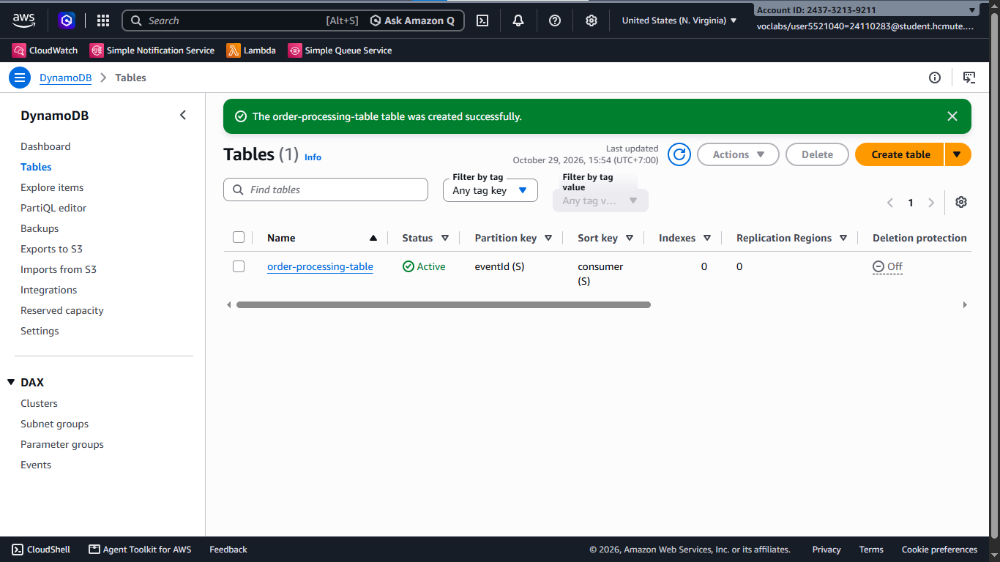

#### DynamoBD > Explore items > order-processing-table > Create item
- Thử tạo một item trong table: `eventId = 000` `consumer = consumer`

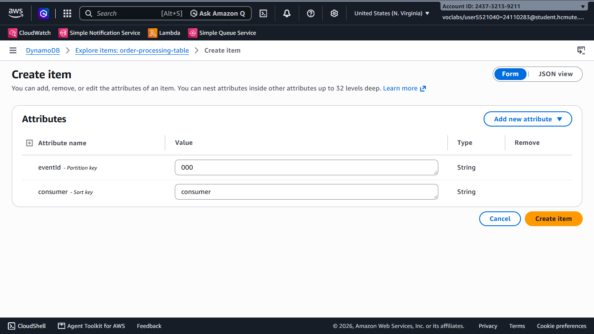

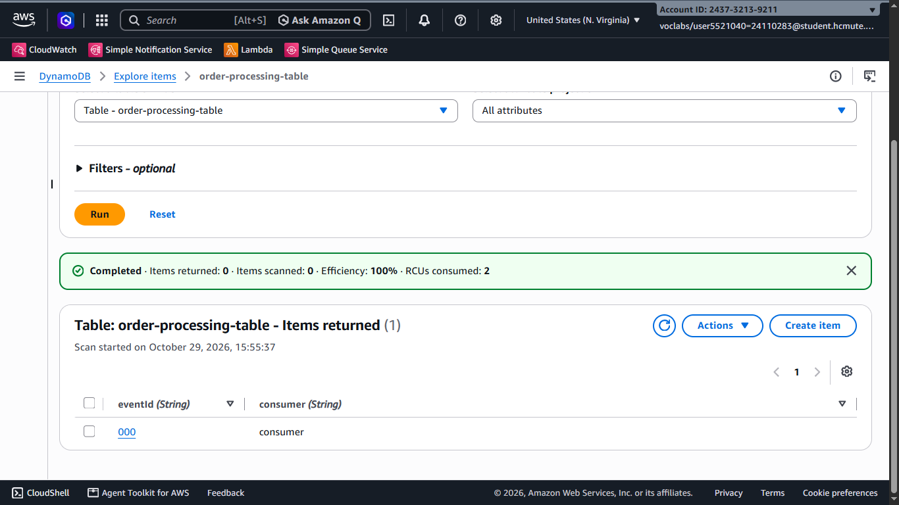

- Xóa item vừa tạo để chuẩn bị kiểm thử

### Tạo và cài đặt SNS alert topic
#### Amazon SNS > Topics > Create topic
- Type: Standard
- Name: consumer-dlq-alert
- Tags: `Project = fanout-sns-sqs` `Owner = 24110283-BDPL`

#### Amazon SNS > Subscriptions > Create subscription
- Topic ARN: consumer-dlq-alert
- Protocol: Email
- Endpoint: 24110283@student.hcmute.edu.vn
- Sau khi tạo topic, mở gmail 24110283@student.hcmute.edu.vn để xem email xác nhận đăng ký topic

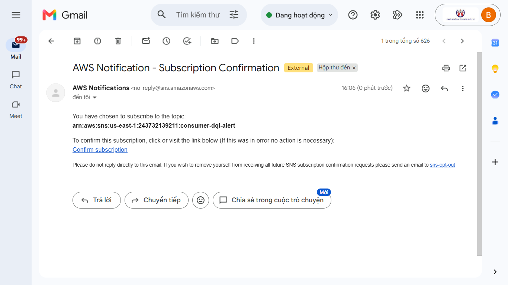

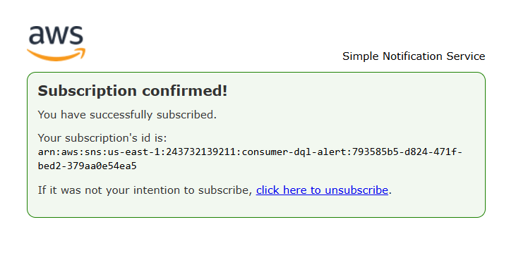

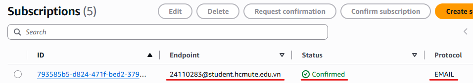

### Tạo và cài đặt CloudWatch alarm
#### CloudWatch > Alarms > Create alarm
- Select metric: All > SQS > Queue metrics > `ApproximateNumberOfMessagesVisible`
- Statistic: Sum
- Period: 1 minute
- Whenever ApproximateNumberOfMessagesVisible is `Greater/Equal` than `1`
- Datapoints to alarm: `1` out of `1`
- Missing data treatment: Treat missing data as good (not breaching threshold)
- Alarm state trigger: In alarm
- Send a notification to `consumer-dlq-alert`
- Alarm name: inventory-dlq-alert/payment-dlq-alert/email-dlq-alert
- Alarm description: inventory-dlq/payment-dlq/email-dlq has message
- Tags: `Project = fanout-sns-sqs` `Owner = 24110283-BDPL`

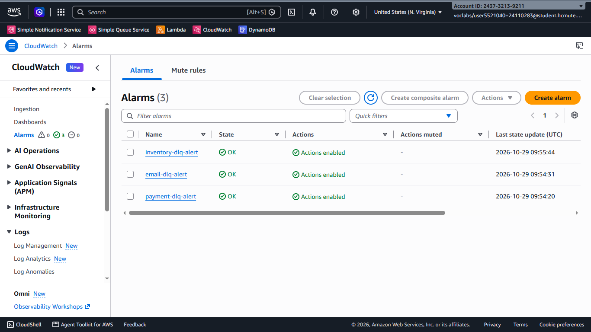

### Sửa code event function của inventory-consumer/payment-consumer/email-consumer
- Thêm chức năng lưu dữ liệu vào DynamoDB bảng order-processing-table
- Dữ liệu lưu vào:
    - Mã event `eventId =`
    - Tên consumer `consumer = CONSUMER_NAME`
    - Thời điểm xử lý `processAt = now.strftime("%d/%m/%Y %H:%M:%S")` có dạng ngày/tháng/năm giờ/phút/giây

### Kiểm tra bảo mật queue
- inventory-queue/payment-queue/email-queue access policy: Chỉ nhận tin nhắn từ order-event-topic `"aws:SourceArn": "arn:aws:sns:us-east-1:243732139211:order-events-topic"`
- Bật mã hóa
    - Server-side encryption: Enabled
    - Encryption key type: Amazon SQS key (SSE-SQS)

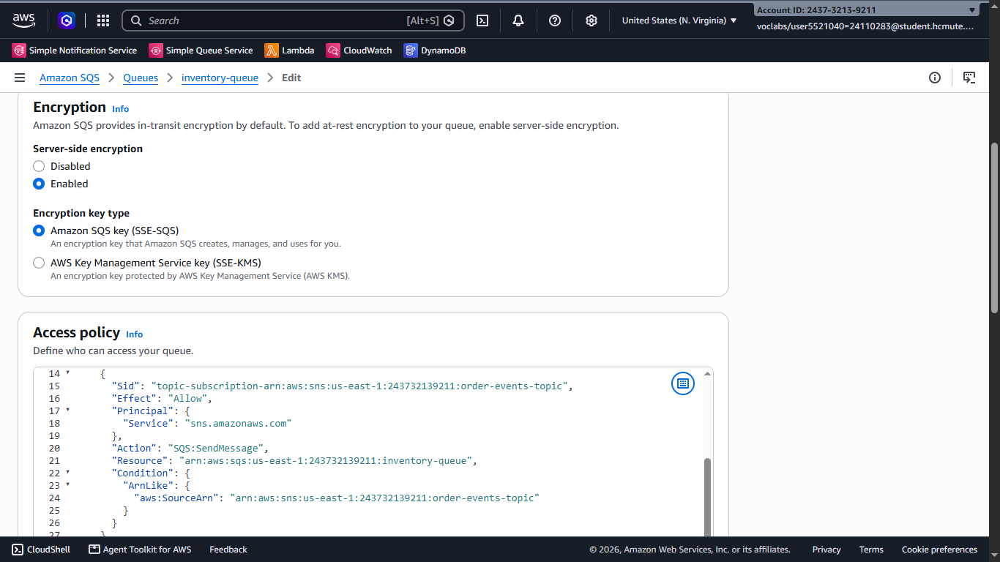

## Kiểm thử
### Test 01
Message attribute `String eventType ORDER_CREATED` `String paymentMethod CARD`
``` json 
{
    "eventId": "evt-001",
    "orderId": "ord-001",
    "customer": "24110283@student.hcmute.edu.vn",
    "amount": "50000",
    "items": {
        "itemId" : "hw-001",
        "quantity" : 2
    }
}
```

Tin nhắn được gửi đến cả ba queue và được xử lý thành công, order-processing-table có thêm ba item

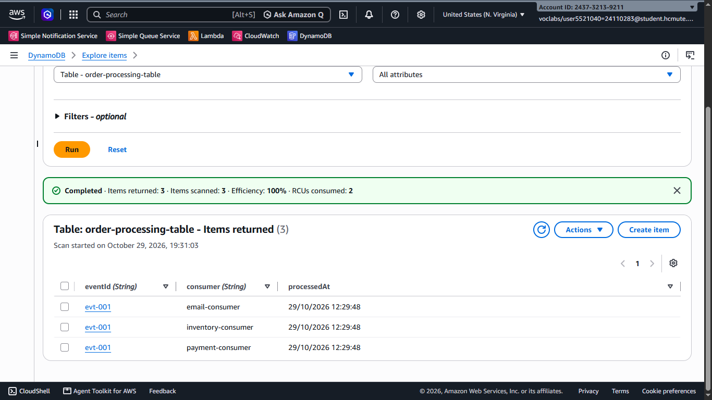

### Test 02
Message attribute `String eventType ORDER_CANCELLED`
``` json
{
    "eventId": "evt-002",
    "orderId": "ord-001",
    "customer": "24110283@student.hcmute.edu.vn",
    "amount": "",
    "items": {
        "itemId" : "",
        "quantity" : ""
    }
}
```

Tin nhắn được gửi đến inventory-queue và email-queue, được xử lý thành công, order-processing-table có thêm hai item

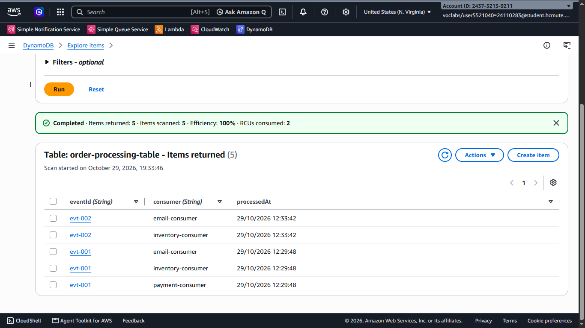

### Test 03
Message attribute `String eventType ORDER_CREATED` `String paymentMethod CARD`
``` json
{
    "eventId": "evt-003",
    "orderId": "ord-002",
    "customer": "24110283@student.hcmute.edu.vn",
    "amount": "-400000",
    "items": {
        "itemId" : "hw-001",
        "quantity" : 0
    }
}
```

Tin nhắn được gửi đến ba queue, xử lý không thành công và được đưa vào các DLQ, các alarm kiểm tra thấy có tin nhắn trong DLQ và gửi email thông báo, dữ liệu order-processing-table không thay đổi

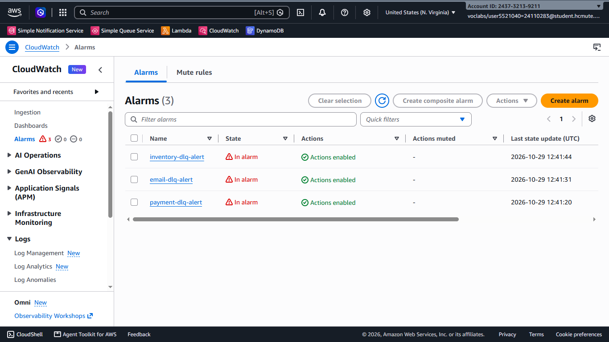

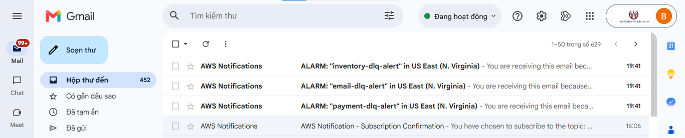

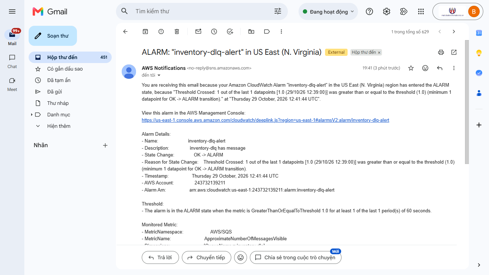

## Tạo IaC bằng CloudFormation
#### CloudFormation > IaC generator
- Start a new scan > Scan all resources
- Create template
    - Template name: fanout-sns-sqs-iac
    - Deletion policy: Delete
    - Update replace policy: Delete
    - Add scanned resources: SNS Topic, SNS Subscription, SQS Queue, Lambda Function, Lambda EventSourceMapping, CloudWatch Alarm, DynamoDB Table

- [File template](https://github.com/BM910/24110283_CLCO332779_05UTExMC/blob/9b35debde38daab49a8a2cfd4cd8bcce7378a881/template/fanout-sns-sqs-iac-template-1793280969643.json)

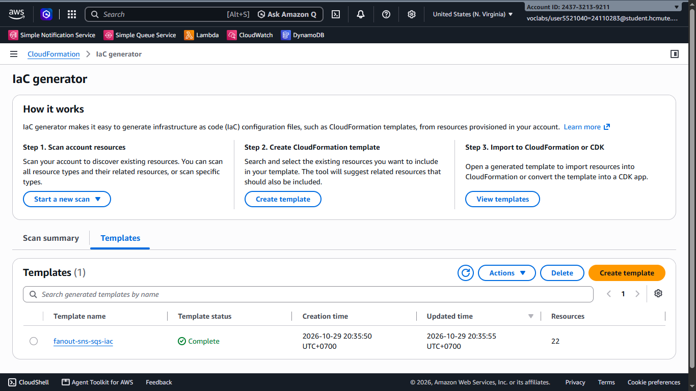

## Links
- [Repo](https://github.com/BM910/24110283_CLCO332779_05UTExMC)
- [File báo cáo](https://github.com/BM910/24110283_CLCO332779_05UTExMC/blob/9b35debde38daab49a8a2cfd4cd8bcce7378a881/tuan_03/bao_cao_tuan_03.md)
- Commits:
    - https://github.com/BM910/24110283_CLCO332779_05UTExMC/commit/38a88e950c9762f8536a2fa9869cfd89880af8e1
    - https://github.com/BM910/24110283_CLCO332779_05UTExMC/commit/9b35debde38daab49a8a2cfd4cd8bcce7378a881
    - https://github.com/BM910/24110283_CLCO332779_05UTExMC/commit/8cd386c17a138e773baa4c1d9f7faade918ed17c
- Ảnh:
    - [alarm_red.png](https://github.com/BM910/24110283_CLCO332779_05UTExMC/blob/9b35debde38daab49a8a2cfd4cd8bcce7378a881/tuan_03/alarm_red.png)
    - [alert_email_content.png](https://github.com/BM910/24110283_CLCO332779_05UTExMC/blob/9b35debde38daab49a8a2cfd4cd8bcce7378a881/tuan_03/alert_email_content.png)
    - [alert_emails.png](https://github.com/BM910/24110283_CLCO332779_05UTExMC/blob/9b35debde38daab49a8a2cfd4cd8bcce7378a881/tuan_03/alert_emails.png)
    - [create_alarms.png](https://github.com/BM910/24110283_CLCO332779_05UTExMC/blob/9b35debde38daab49a8a2cfd4cd8bcce7378a881/tuan_03/create_alarms.png)
    - [create_item_test_01.png](https://github.com/BM910/24110283_CLCO332779_05UTExMC/blob/9b35debde38daab49a8a2cfd4cd8bcce7378a881/tuan_03/create_item_test_01.png)
    - [create_item_test_02.png](https://github.com/BM910/24110283_CLCO332779_05UTExMC/blob/9b35debde38daab49a8a2cfd4cd8bcce7378a881/tuan_03/create_item_test_02.png)
    - [create_table.png](https://github.com/BM910/24110283_CLCO332779_05UTExMC/blob/9b35debde38daab49a8a2cfd4cd8bcce7378a881/tuan_03/create_table.png)
    - [dynamo_test_01.png](https://github.com/BM910/24110283_CLCO332779_05UTExMC/blob/9b35debde38daab49a8a2cfd4cd8bcce7378a881/tuan_03/dynamo_test_01.png)
    - [dynamo_test_02.png](https://github.com/BM910/24110283_CLCO332779_05UTExMC/blob/9b35debde38daab49a8a2cfd4cd8bcce7378a881/tuan_03/dynamo_test_02.png)
    - [iac_template.png](https://github.com/BM910/24110283_CLCO332779_05UTExMC/blob/9b35debde38daab49a8a2cfd4cd8bcce7378a881/tuan_03/iac_template.png)
    - [queue_encryption_and_access.png](https://github.com/BM910/24110283_CLCO332779_05UTExMC/blob/9b35debde38daab49a8a2cfd4cd8bcce7378a881/tuan_03/queue_encryption_and_access.png)
    - [subscription_confirm_01.png](https://github.com/BM910/24110283_CLCO332779_05UTExMC/blob/9b35debde38daab49a8a2cfd4cd8bcce7378a881/tuan_03/subscription_confirm_01.png)
    - [subscription_confirm_02.png](https://github.com/BM910/24110283_CLCO332779_05UTExMC/blob/9b35debde38daab49a8a2cfd4cd8bcce7378a881/tuan_03/subscription_confirm_02.png)
    - [subscription_confirm_03.png](https://github.com/BM910/24110283_CLCO332779_05UTExMC/blob/9b35debde38daab49a8a2cfd4cd8bcce7378a881/tuan_03/subscription_confirm_03.png)
- Code:
    - [test_03_payload.json](https://github.com/BM910/24110283_CLCO332779_05UTExMC/blob/9b35debde38daab49a8a2cfd4cd8bcce7378a881/test_payload/test_03_payload.json)
    - [test_02_payload.json](https://github.com/BM910/24110283_CLCO332779_05UTExMC/blob/9b35debde38daab49a8a2cfd4cd8bcce7378a881/test_payload/test_02_payload.json)
    - [test_01_payload.json](https://github.com/BM910/24110283_CLCO332779_05UTExMC/blob/9b35debde38daab49a8a2cfd4cd8bcce7378a881/test_payload/test_01_payload.json)
    - [fanout-sns-sqs-iac-template-1793280969643.json](https://github.com/BM910/24110283_CLCO332779_05UTExMC/blob/9b35debde38daab49a8a2cfd4cd8bcce7378a881/template/fanout-sns-sqs-iac-template-1793280969643.json)
    - [payment_consumer.py](https://github.com/BM910/24110283_CLCO332779_05UTExMC/blob/9b35debde38daab49a8a2cfd4cd8bcce7378a881/lambda/payment_consumer.py)
    - [inventory_consumer.py](https://github.com/BM910/24110283_CLCO332779_05UTExMC/blob/9b35debde38daab49a8a2cfd4cd8bcce7378a881/lambda/inventory_consumer.py)
    - [email_consumer.py](https://github.com/BM910/24110283_CLCO332779_05UTExMC/blob/9b35debde38daab49a8a2cfd4cd8bcce7378a881/lambda/email_consumer.py)


## Sử dụng AI: Không sử dụng

## Kế hoạch tuần 4
Kiểm thử tổng thể, tối ưu chi phí, dọn dẹp tài nguyên, viết báo cáo và demo (dưới 10 phút)