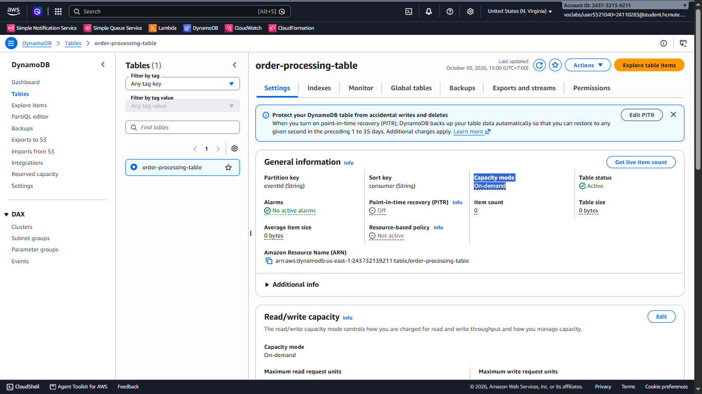
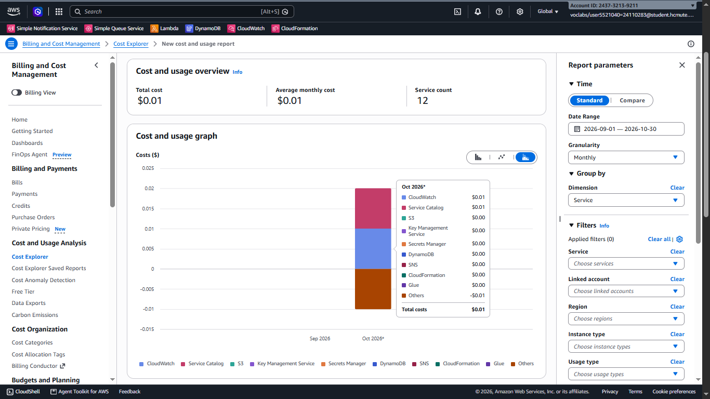
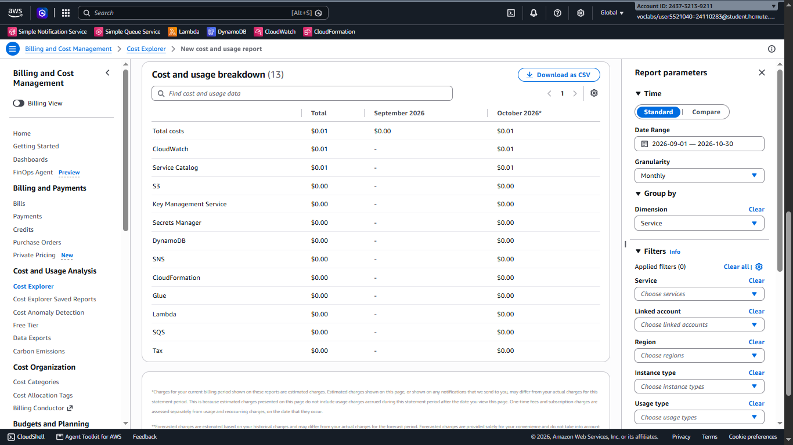
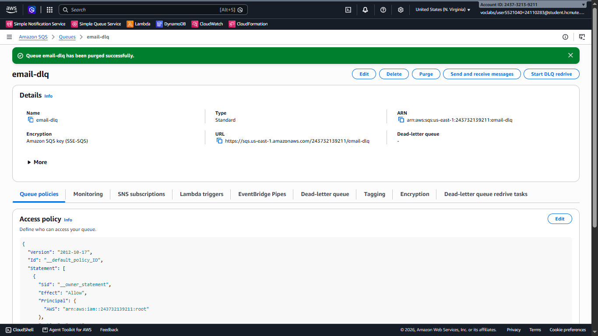
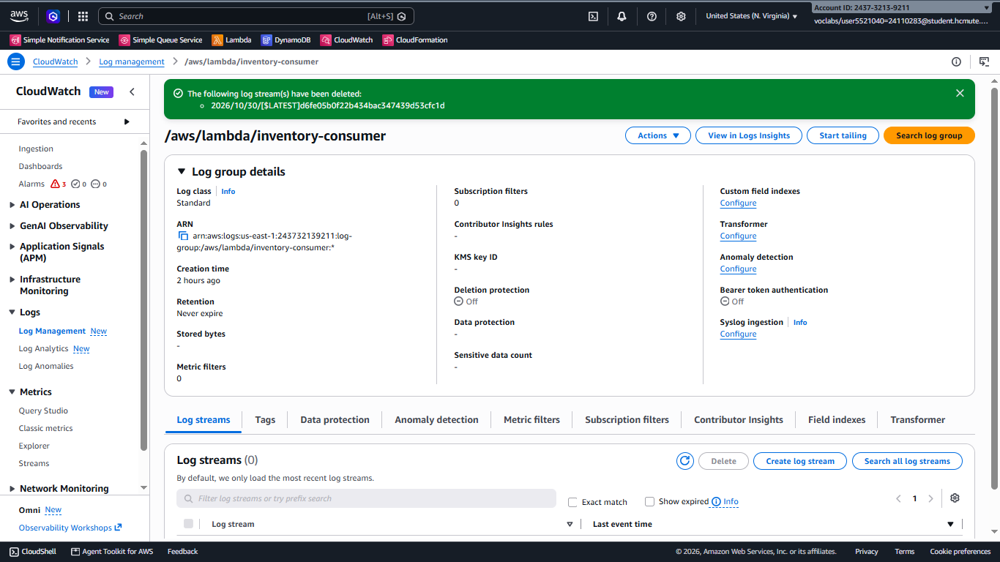
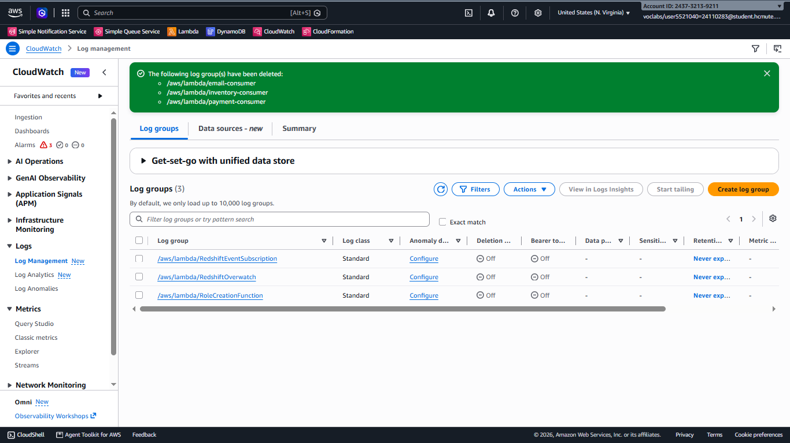
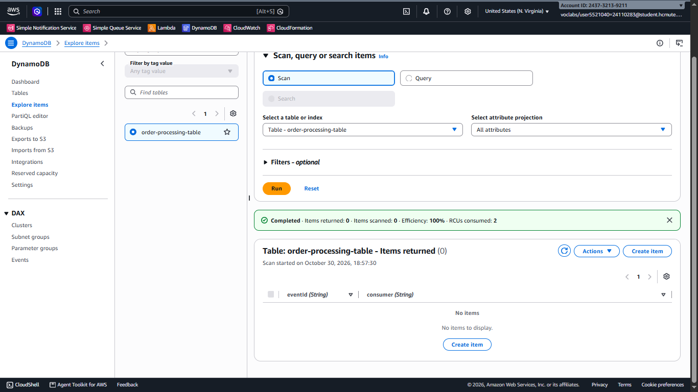

# Kiến trúc fan-out với SNS và nhiều hàng đợi SQS 
# Tuần 4
## Worklog
- Kiểm thử tổng thể: 1 tiếng
- Video demo: 2 tiếng
- Tối ưu chi phí: 15 phút
- Dọn dẹp tài nguyên: 15 phút
- Viết báo cáo dự án: 5 tiếng

## Kiểm thử tổng thể
#### Xác nhận lại cấu hình:
- SNS: Topic, Subscription, Filter, Tag
- SQS: Queue, Access policy, Encryption, Tag
- Lambda: Event function, Code, Permission, Trigger (Event source mappings), Tag
- DynamoDB: Settings, Tag
- CloudWatch: Logs, Alarm
Tất cả đúng cấu hình

#### Kiểm thử bằng payload
Kiểm thử bằng payload đã thực hiện trong quá trình quay video demo

## Video demo
Quay video demo dự án xử lý các sự kiện publish từ topic, lambda, alarm, dynamodb hoạt động bình thường, kiểm thử bằng payload đạt kết quả đúng

## Tối ưu chi phí
### Kiểm tra cài đặt
Kiểm tra DynamoDB bảng order-processing-table có cài đặt Capacity mode: On-demand

### Chi phí trong quá trình thực hiện dự án
Từ ngày 01/09/2026 đến ngày 30/10/2026 dự án đã sử dụng tổng cộng $0.01

## Dọn dẹp tài nguyên
- Dọn inventory-dlq/payment-dlq/email-dlq bằng Purge

- Dọn Log stream và Log group

- Dọn các item trong order-processing-table

## Viết báo cáo
Tổng hợp thông tin từ Rubric, báo cáo tuần 1, 2, 3 và ảnh chụp để viết báo cáo

## Links
- [Repo](https://github.com/BM910/24110283_CLCO332779_05UTExMC)
- File báo cáo
- Commits:
    - https://github.com/BM910/24110283_CLCO332779_05UTExMC/commit/68eb28ccfcf750ec3fd519dd2b9d1b4caa18f2d1
    - https://github.com/BM910/24110283_CLCO332779_05UTExMC/commit/e82043b2a4e3c911efe39a65dacf85eb5ae677c3
    - https://github.com/BM910/24110283_CLCO332779_05UTExMC/commit/2f4620eb68ba628156a98d3cbbae7e24c6dc5d91
    - https://github.com/BM910/24110283_CLCO332779_05UTExMC/commit/7f006b764d5d544be78ad8ea30232fceb612e06a
- Ảnh:
    - [clean_up_dlq.png](https://github.com/BM910/24110283_CLCO332779_05UTExMC/blob/7f006b764d5d544be78ad8ea30232fceb612e06a/tuan_04/clean_up_dlq.png)
    - [clean_up_dynamodb_table.png](https://github.com/BM910/24110283_CLCO332779_05UTExMC/blob/7f006b764d5d544be78ad8ea30232fceb612e06a/tuan_04/clean_up_dynamodb_table.png)
    - [clean_up_log_group.png](https://github.com/BM910/24110283_CLCO332779_05UTExMC/blob/7f006b764d5d544be78ad8ea30232fceb612e06a/tuan_04/clean_up_log_group.png)
    - [clean_up_log_stream.png](https://github.com/BM910/24110283_CLCO332779_05UTExMC/blob/7f006b764d5d544be78ad8ea30232fceb612e06a/tuan_04/clean_up_log_stream.png)
    - [cost_and_usage_breakdown.png](https://github.com/BM910/24110283_CLCO332779_05UTExMC/blob/7f006b764d5d544be78ad8ea30232fceb612e06a/tuan_04/cost_and_usage_breakdown.png)
    - [cost_and_usage_graph.png](https://github.com/BM910/24110283_CLCO332779_05UTExMC/blob/7f006b764d5d544be78ad8ea30232fceb612e06a/tuan_04/cost_and_usage_graph.png)
    - [dynamodb_settings.png](https://github.com/BM910/24110283_CLCO332779_05UTExMC/blob/7f006b764d5d544be78ad8ea30232fceb612e06a/tuan_04/dynamodb_settings.png)
- Code:
    - [email_consumer.py](https://github.com/BM910/24110283_CLCO332779_05UTExMC/blob/7f006b764d5d544be78ad8ea30232fceb612e06a/lambda/email_consumer.py)
    - [inventory_consumer.py](https://github.com/BM910/24110283_CLCO332779_05UTExMC/blob/7f006b764d5d544be78ad8ea30232fceb612e06a/lambda/inventory_consumer.py)
    - [payment_consumer.py](https://github.com/BM910/24110283_CLCO332779_05UTExMC/blob/7f006b764d5d544be78ad8ea30232fceb612e06a/lambda/payment_consumer.py)
    - [fanout-sns-sqs-iac-template-1793342745945.json](https://github.com/BM910/24110283_CLCO332779_05UTExMC/blob/7f006b764d5d544be78ad8ea30232fceb612e06a/template/fanout-sns-sqs-iac-template-1793342745945.json)
    - [test_01_payload.json](https://github.com/BM910/24110283_CLCO332779_05UTExMC/blob/7f006b764d5d544be78ad8ea30232fceb612e06a/test_payload/test_01_payload.json)
    - [test_02_payload.json](https://github.com/BM910/24110283_CLCO332779_05UTExMC/blob/7f006b764d5d544be78ad8ea30232fceb612e06a/test_payload/test_02_payload.json)
    - [test_03_payload.json](https://github.com/BM910/24110283_CLCO332779_05UTExMC/blob/7f006b764d5d544be78ad8ea30232fceb612e06a/test_payload/test_03_payload.json)
- [so_do.drawio](https://github.com/BM910/24110283_CLCO332779_05UTExMC/blob/7f006b764d5d544be78ad8ea30232fceb612e06a/architecture/so_do.drawio)
- [so_do.png](https://github.com/BM910/24110283_CLCO332779_05UTExMC/blob/7f006b764d5d544be78ad8ea30232fceb612e06a/architecture/so_do.png)
- [bao_cao_du_an.docx](https://github.com/BM910/24110283_CLCO332779_05UTExMC/blob/7f006b764d5d544be78ad8ea30232fceb612e06a/bao_cao_du_an.docx)
- [demo.mp4](https://github.com/BM910/24110283_CLCO332779_05UTExMC/blob/7f006b764d5d544be78ad8ea30232fceb612e06a/demo.mp4)

## Sử dụng AI: Không sử dụng